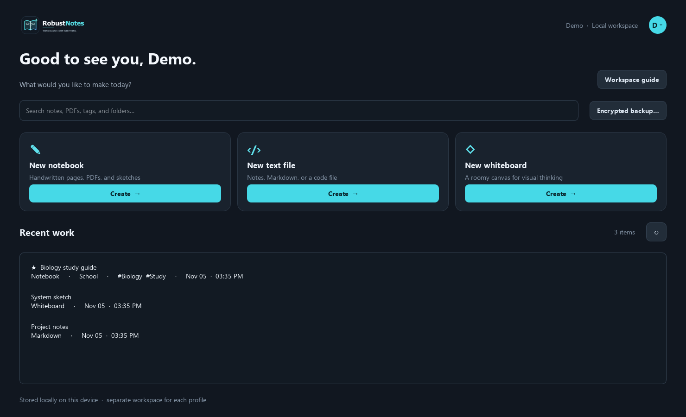
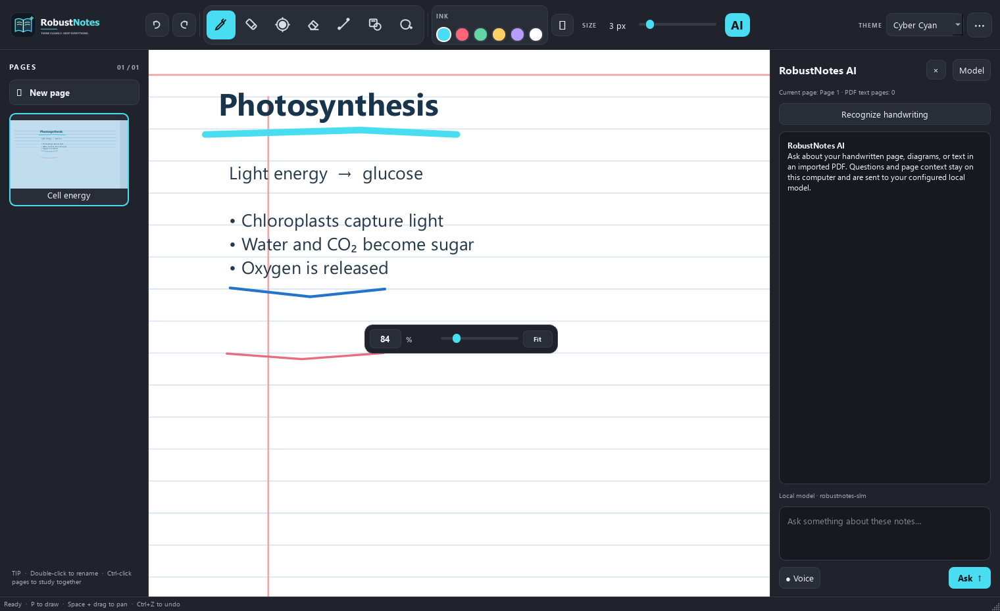

<p align="center">
  
</p>

<h1 align="center">RobustNotes</h1>

<p align="center">
  A local-first workspace for handwritten notes, PDFs, code, and visual thinking.
</p>

RobustNotes brings notebook pages, whiteboards, and plain-text or code files into one desktop app. It combines pen tools and PDF annotation with searchable text, handwriting recognition, study cards, local profiles, and encrypted backups.

> Screenshots below show the actual RobustNotes interface with fictional sample content. They contain no personal notes.

## Screenshots

### Workspace dashboard

Create notebooks, text files, and whiteboards from one dashboard. Search can match document names, note text, PDF text, OCR results, tags, and folders.



### Notebook editor

Annotate notebook pages with pen, highlighter, laser, shape, lasso, scale, and compass tools. The optional AI sidebar can use the current page and imported PDF text as context.



## What makes RobustNotes distinctive

RobustNotes is designed around a particular combination of workflows:

- **One desktop workspace for three kinds of work:** handwritten notebooks, open whiteboards, and code-friendly text files.
- **A practical notebook canvas:** stylus pressure, shape snapping, PDF import, OCR, page templates, measuring tools, and page-level study cards sit alongside everyday ink tools.
- **Search across handwriting and documents:** find matching text from typed files, imported PDF text, OCR, page names, tags, and folders in one local workspace.
- **Local profiles with user-separated files:** each profile has its own workspace on the device. There is no required cloud account or built-in sync service.
- **Optional local-model workflow:** page-aware chat is designed for a locally hosted model endpoint. The model and its runtime are not bundled with RobustNotes.
- **Recovery and portability:** local version snapshots, plus manually created password-encrypted backups that can be saved to a folder of the user's choice.

These are RobustNotes' product priorities and the way its features are put together; this README makes no claim that competing products lack every individual capability.

## Features

### Notes and workspace

- Create notebooks, whiteboards, and plain-text, Markdown, or code files.
- Keep profiles and documents in device-local storage, separated by profile.
- Search across document titles, text files, notebook page names, searchable PDF text, recognized handwriting, tags, and folders.
- Organize documents with favorites, tags, logical folders, and links/backlinks.
- Reorder notebook pages by dragging them in the page rail.
- Duplicate a notebook page, clear its annotations, rename it, or restore a saved version.
- Choose Dot grid, Cornell notes, Meeting notes, or Weekly planner page layouts.

### Drawing, PDF, and study tools

- Pen, highlighter, eraser, laser pointer, line, shape, and freehand or rectangular lasso tools.
- Pressure-sensitive pen input on compatible stylus devices; the mouse continues to work as usual.
- Freehand shape snapping for common geometric sketches.
- On-canvas calculator, scale/ruler, and compass.
- Import PDF pages into a notebook, annotate them, and export notebooks as PDFs or individual pages as PNG images.
- Recognize handwriting with the optional local TrOCR-based OCR stack. Review and edit recognized text before keeping it as page context.
- Create cloze-style study cards from selected pages with PDF or recognized text.
- Focus mode hides the editor chrome. Theme choices include a high-contrast option.
- Zoom starts at 84%; type a zoom value or use the lower-corner zoom controls.

### AI, voice, and music

- Toggle the page-aware AI sidebar open or closed.
- Ask questions using the current page image and any available imported PDF or OCR text.
- Optional voice input converts speech to text locally when the speech-recognition dependencies are installed.
- Connect to a Navidrome server through the Subsonic API for in-app music streaming.

**AI integration status:** the current desktop chat adapter expects a locally hosted Ollama-compatible chat endpoint (configurable in the app or with `ROBUSTNOTES_OLLAMA_URL` and `ROBUSTNOTES_MODEL`). It does not call the ChatGPT API. RobustNotes' own trained SLM and its runtime are not included in this repository yet; connecting that model is future integration work.

### Privacy, backup, and recovery

- Local profiles are stored separately on the device. Profile passwords are stored as salted PBKDF2 hashes.
- Notebook and text-file contents remain in the profile's local workspace unless the user explicitly exports, backs them up, or configures the AI chat to send context to a non-local endpoint. The default chat endpoint is loopback; check the configured endpoint before asking about private notes.
- The **Encrypted backup** action creates an AES-GCM password-encrypted archive at a user-selected destination; restore is also available in the app.
- Notebook recovery snapshots are saved locally while documents are edited, with a small rolling history per file.
- RobustNotes has no built-in cloud sync. A chosen backup folder may be a folder synchronized by another service, at the user's discretion.

## Project status

| Target | Status |
| --- | --- |
| Windows desktop | PySide6 app; Windows app bundle can be built with PyInstaller |
| Windows installer | Inno Setup definition and build script are included |
| Linux desktop | Run from Python or build on Linux with PyInstaller; builds must be made on the target OS |
| Android | Native Kotlin/Jetpack Compose starter with local text-note create, edit, and delete |

The Android app is an early companion-app shell, not desktop feature parity. Its next milestones are a touch/stylus canvas, PDF support, OCR, and encrypted backup. Android builds need Android Studio/SDK 35 and JDK 17 or a compatible newer JDK.

## Run from source

Python 3.10+ is recommended. From the repository root:

### Windows PowerShell

```powershell
python -m venv .venv
.\.venv\Scripts\Activate.ps1
python -m pip install --upgrade pip
python -m pip install -r requirements.txt
python canvas_app.py
```

### Linux

```bash
python3 -m venv .venv
source .venv/bin/activate
python -m pip install --upgrade pip
python -m pip install -r requirements.txt
python canvas_app.py
```

PDF support uses QtPdf and microphone input uses QtMultimedia from the installed PySide6 package. Features that depend on unavailable Qt modules display an in-app explanation.

### Optional handwriting OCR

Install the larger OCR dependencies separately:

```powershell
python -m pip install -r ocr-requirements.txt
```

The first OCR run downloads the TrOCR model into the current user's local model cache. The OCR image and recognition step run locally; the weights are not included in the base app bundle.

## Build

### Windows app bundle and installer

Install Inno Setup 6, ensure `ISCC.exe` is available on `PATH`, then run from the project root:

```powershell
.\packaging\build_windows.ps1
```

The portable application bundle is placed in `dist\RobustNotes`. The installer is written to `packaging\output\RobustNotes-Setup-0.1.0.exe`. The base bundle omits the optional OCR runtime to keep its size manageable; see `packaging/README.md` and `ocr-requirements.txt`.

### Linux application bundle

Build on Linux (PyInstaller does not cross-compile Windows apps into Linux binaries):

```bash
python3 -m pip install -r requirements.txt pyinstaller
python3 -m PyInstaller --noconfirm --onedir --windowed \
  --name RobustNotes --add-data "assets:assets" canvas_app.py
```

The app bundle is created under `dist/RobustNotes`.

### Android debug APK

The Gradle wrapper and Android project are under `mobile/android`. Install Android SDK Platform 35, set the local `sdk.dir` in `mobile/android/local.properties` if Android Studio has not created it, then run:

```powershell
Set-Location .\mobile\android
.\gradlew.bat assembleDebug
```

The debug APK is written to `app\build\outputs\apk\debug\app-debug.apk`. See [mobile/README.md](mobile/README.md) for details.

## Keyboard shortcuts

| Shortcut | Action |
| --- | --- |
| `P` | Pen |
| `H` | Highlighter |
| `Z` | Laser |
| `E` | Eraser |
| `I` | Line |
| `S` | Shapes |
| `L` | Lasso / selection |
| `Ctrl+N` | New page |
| `Ctrl+Z` / `Ctrl+Y` | Undo / redo |
| `Ctrl+F` | Focus dashboard search |
| `F11` / `Esc` | Toggle / leave focus mode |
| `Space` + drag | Pan around the page |
| `1`–`6` | Select an ink swatch |

## Repository layout

```text
assets/             Logo, page templates, and sample PDF
docs/screenshots/   README screenshots made with fictional demo content
mobile/android/     Native Android starter and Gradle wrapper
packaging/          PyInstaller and Inno Setup build configuration
.gitignore          Local data, build, and Python cache exclusions
canvas_app.py       PySide6 desktop app
ocr-requirements.txt Optional local OCR dependencies
requirements.txt    Desktop runtime dependencies
```

## License

No license has been added yet. Check with the author before reusing or redistributing this project.
